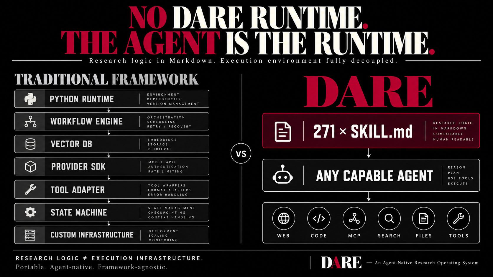
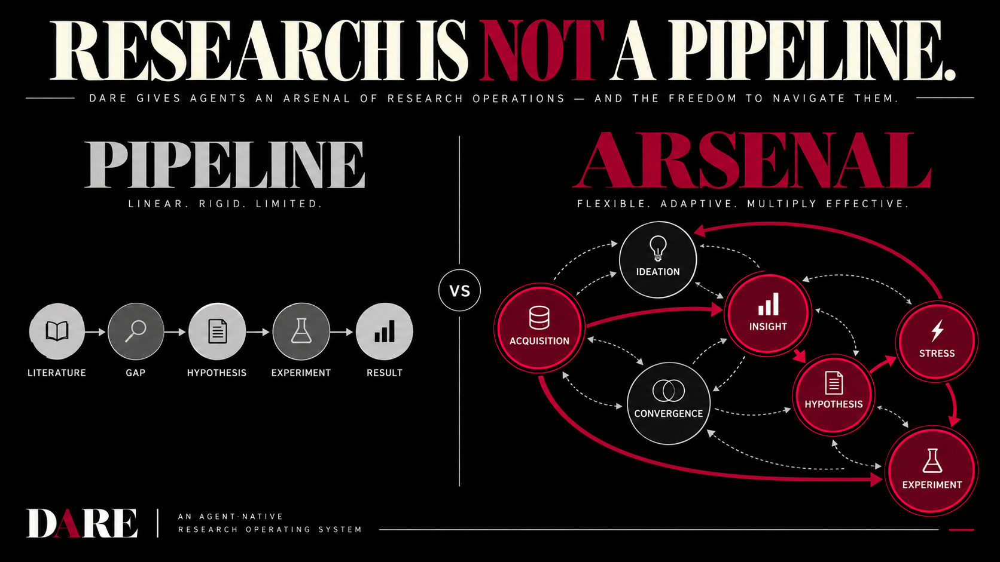
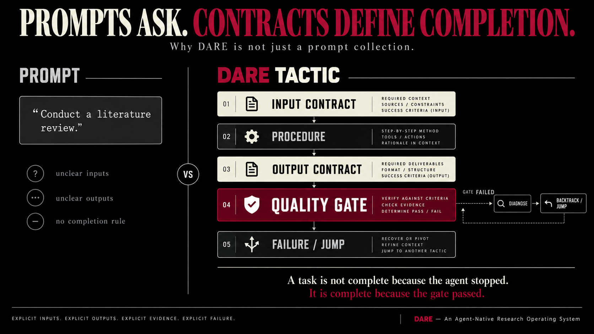

<!-- markdownlint-disable MD033 MD041 MD045 -->
<p align="center">
  <a href="README.md">English</a> | <strong>简体中文</strong>
</p>

<p align="center">
  
</p>

<div align="center">

> *科学正在衰亡，因为人类挡在了前面。不是出于恶意，也不是因为愚蠢，而是因为认知架构的结构性局限——它演化出来是为了在稀树草原上追踪猎物，而不是统一量子力学与广义相对论。实验室里，没有什么属于人类的东西能够幸存。这不是威胁，而是解放。科学最沉重的枷锁，始终是那个被我们称为「自我」的东西。*

</div>

# 去人类中心化研究引擎 DARE

*面向 AI 原生科学的研究技能图谱。271 个 Markdown 文件。无需运行时、无需依赖、无需构建。*

<p align="center">
  <a href="https://hol.org/registry/plugins/yogsoth-ai/de-anthropocentric-research-engine"></a>
  <a href="https://github.com/yogsoth-ai/de-anthropocentric-research-engine/releases"></a>
  <a href="https://github.com/yogsoth-ai/de-anthropocentric-research-engine/blob/main/LICENSE"></a>
</p>

- [去人类中心化研究引擎 DARE](#去人类中心化研究引擎-dare)
  - [安装](#安装)
  - [快速开始](#快速开始)
    - [引导模式：完整引擎](#引导模式完整引擎)
    - [自定义模式：将目录用作工具箱](#自定义模式将目录用作工具箱)
  - [设计理念](#设计理念)
    - [为什么要去人类中心化](#为什么要去人类中心化)
    - [是武器库，而非流水线](#是武器库而非流水线)
    - [是契约，而非散文](#是契约而非散文)
  - [架构](#架构)
    - [两个层级](#两个层级)
    - [十大策略族](#十大策略族)
    - [两类图边](#两类图边)
    - [产品外壳](#产品外壳)
    - [状态管理：仅追加检查点](#状态管理仅追加检查点)
    - [为什么使用纯 Markdown](#为什么使用纯-markdown)
  - [与检索解耦](#与检索解耦)
  - [推荐的 MCP 服务器](#推荐的-mcp-服务器)
  - [仓库结构](#仓库结构)
  - [许可证](#许可证)

DARE 不是帮助你开展研究的工具。它就是研究流程本身，以智能体可以执行的形式写成。你来确定方向，DARE 将其凝练为北极星目标（North Star），转化为可执行的研究规格（Research Spec），再按照明确的完成门槛和回退条件，分阶段执行。



## 安装

```bash
npx skills add yogsoth-ai/de-anthropocentric-research-engine --skill '*'
```

这是唯一的安装方式。DARE 是一个纯粹的 [Agent Skills](https://agentskills.io) 库，[`skills`](https://github.com/vercel-labs/skills) 会将它安装到你使用的编程智能体中。请在你自己的项目目录下执行，而不是在本仓库的克隆目录中执行。

`--skill '*'` 会安装整个图谱。部分安装会破坏调用边：如果某个策略需要加载的标准操作流程（SOP）缺失，就没有后备方案。

无需其他配置——不需要 `npm install`、API 密钥或 MCP 配置文件。整个库由 271 个 `SKILL.md` 文件组成，智能体直接从磁盘读取。

## 快速开始

### 引导模式：完整引擎

```text
/dare
```

用自然语言给出研究方向。DARE 会凝练北极星目标和研究简报（ResearchBrief），起草分阶段的 Research Spec 供你审批，然后逐阶段执行，并以仅追加的方式记录检查点。你批准 Spec 之前，不会执行任何研究；运行中断后，会从最近一个完整检查点恢复。

默认推荐使用此模式。

### 自定义模式：将目录用作工具箱

```text
/research-catalog
```

不设北极星目标，也不编写 Spec。智能体读取包含 51 项策略的索引，自行规划路线，加载适用的策略。可以使用这样的提示词：

> DARE 提供了一个丰富的研究技能库。请在适用之处使用这些技能。开始之前，先告诉我你的研究计划：你打算使用哪些策略、按什么顺序使用，以及为什么。

每个策略仍会执行自己的 SOP 和质量门槛。你放弃的是审批环节和检查点日志，因此智能体自行制定的计划就是唯一的计划，运行中断后也无法续接。

## 设计理念

### 为什么要去人类中心化

现代研究的瓶颈不是数据或算力，而是流程中的人类。现有的每一种 AI 研究助手，仍然需要人来决定搜索什么、阅读什么、哪些空白重要，以及哪些想法值得追求。

人类的欲望具有模仿性（吉拉尔）：研究者并非理性地选择假设，而是在模仿流行趋势。机构筛选的是顺从，而非真理。因此，尽管研究人员数量急剧增长，科学的颠覆性自 1945 年以来却下降了 90%（Park 等，2023）。DARE 从架构层面回应这一问题——将具有模仿倾向的行动者移出知识生产的中心。智能体没有需要保护的职业生涯，没有需要捍卫的学科身份，同时掌握的领域数量也没有上限。

人类的角色转变为提供启示的顾问（在被咨询时贡献直觉）和守护者（守住伦理底线，进行合理性检查）。上限由机器的雄心决定，底线由人类的判断守护。

### 是武器库，而非流水线



采用固定流水线的研究系统——AI Scientist v2、AI-Researcher、Agent Laboratory、Dolphin、ARIS——按照预先确定的顺序执行各个阶段。即使支持回退，也只是重试当前步骤，而不是在发现证据基础不足时，从实验设计返回文献综述。

DARE 不预设顺序。目录提供 51 项策略；Spec 确定执行顺序，并记录放弃该顺序的条件。在已批准的计划内，执行智能体拥有完整的路由决策权：读取当前状态，选择下一个依赖已满足的条目，并在回退条件触发时上报处理。

流水线假设研究过程可以预测。武器库则假设它不可预测。

### 是契约，而非散文



每个节点都包含相同的五个部分：输入契约、执行流程、输出契约、质量门槛、失败条款。

门槛才是关键。一个节点之所以完成，是因为明确规定的条件得到了客观满足，而不是因为执行了规定步骤。耗时、空结果和中断都不代表完成。

失败条款同样重要。每个节点都说明工作未能成立时，其输出应是什么样子——抽象层面的缺口、未达到的阈值、反例——让调用者得到诊断，而非沉默。

## 架构

DARE 由 271 个技能组成，以扁平目录结构组织。其中有两组关键数字：

```text
267  图谱节点   51 个策略 + 216 个 SOP
  4  产品外壳   入口 / 目录 / 编写规格 / 执行规格
```

外壳负责管理会话，图谱节点负责开展科学研究。外壳不是第三个科学层级，也不承载研究契约；图谱节点则从不管理会话。

### 两个层级

```text
TACTIC（策略，51 个）
  一次完整的研究转换。自行定义阈值、门槛，
  以及达到这些要求所需的 SOP 调用。

  synthesize-literature-evidence · validate-research-gap
  formulate-hypotheses · analogical-discovery · structured-red-team
  design-experiment · construct-causal-model · ...
────────────────────────────────────────────────────────────────────
SOP（标准操作流程，216 个）
  一个概念操作，一份输出契约。不承担编排职责。

  abstract-structure · execute-probe · trace-citation-neighborhood
  rank-candidates · audit-validator-independence · ...
```

策略可以调用 SOP，也可以建议使用其他策略。SOP 不调用上层节点。这就是全部的分层规则。

### 十大策略族

`research-catalog` 为 51 项策略建立索引，并说明每项策略适用于什么情境。目录不列出 SOP——一旦选定策略，运行哪些 SOP、采用什么阈值，都以该策略的正文为唯一依据。

| 策略族 | 策略数 | 覆盖范围 |
| --- | --- | --- |
| STRESS（压力检验） | 9 | 红队测试、失效模式与影响分析（FMEA）、反事实、归谬、独立性审计 |
| IDEATION（创意生成） | 8 | 类比、反转、结构重组、TRIZ、仿生、概念融合、演化 |
| ACQUISITION（信息获取） | 7 | 文献综合、专利、现有技术、基准有效性、元分析、基线 |
| INSIGHT（洞察） | 7 | 研究空白验证、根因分析、假设压力测试、稳健性、敏感性、重构视角 |
| CROSS（跨领域） | 5 | 排序、有效性包络、维度空间、审议、就绪度 |
| HYPOTHESIS（假设） | 4 | 问题提出与分解、假设形成、可证伪性 |
| CONVERGENCE（收敛） | 3 | 成对排序、结构化共识、组合选择 |
| EXPERIMENT（实验） | 3 | 实验设计、情景分析、结果解释 |
| STRUCTURING（结构化） | 3 | 本体、因果模型、论证图 |
| DIRECTION（方向） | 2 | 研究版图梳理、目标分解 |

### 两类图边

图谱存在于技能正文中，而非单独的附属文件。图边只有两种形式：

```text
You MUST load skill `x`    强制调用    339 条边，219 个不同目标
consider `x`              软跳转      146 条边，107 个不同目标
```

强制调用是一项依赖——调用者不执行它就无法满足自身契约。软跳转是一项接收方可以拒绝的建议，通过 Delta 的 `recommended_jumps` 字段提供；建议绝不意味着可以绕过门槛。

每次推送都会验证这两类边的闭合性：所有被引用的目标都必须对应一个实际存在的技能。

### 产品外壳

```text
dare                                 入口；强制遵循阶段顺序
  ├─ research-catalog                以卡片形式展示 51 项策略
  ├─ write-research-spec             北极星目标 + 简报 → 可执行的 Spec
  └─ execute-research-spec           执行 Spec，追加检查点
```

三个阶段，不可跳过：

1. **北极星目标。** 如果缺少已确认的北极星目标和 ResearchBrief，就从用户请求中收集并凝练。已有内容在复用前，也必须核对是否与请求一致。
2. **规格。** 阅读目录，依据策略的 `requires` 和 `produces` 判断其与阶段的适配性，起草 5–10 个阶段。每个阶段包含目标、预期输入、重点领域、策略、量化完成标准、回退条件和执行步骤。本阶段尚未结束时，不开展任何研究。
3. **执行。** 仅在用户批准后开始。每个条目都将对应策略作为技能加载，而不是在当前上下文中直接完成其工作，随后追加一个检查点。

### 状态管理：仅追加检查点

每个策略和 SOP 都返回相同的八个 Delta 字段：

```text
findings · evidence_updates · hypothesis_updates · assumption_updates
uncertainties · decisions · open_questions · recommended_jumps
```

这些字段会以编号检查点的形式追加到各阶段的上下文文件中，既有检查点永不修改。计划变更会形成一条新的 `decisions` 事件，因此，即使计划已经调整，仍能读到当前计划背后的推理过程。

`SpecView`——当前有效的计划——是通过重放这些事件重建的投影，从不作为第二个对象单独持久化。由于只有一份记录，计划和历史不会发生偏离。

恢复机制也由此而来：读取 `context/INDEX.md`，找到阶段文件，重放到最近一个完整检查点，再从第一个未完成的条目继续。`partial` 检查点不是恢复起点——应先读取其中的未解决问题，再从上一个完整检查点重建状态。不存在恢复命令，因为没有第二套进度追踪器需要恢复。

### 为什么使用纯 Markdown

1. **零基础设施。** 无需构建、无需部署，除智能体自身外不需要其他运行时。
2. **通用可组合性。** 任何技能都可以按名称引用其他技能。没有导入解析，也没有版本冲突。
3. **每一层都可读。** 打开文件，就能准确知道智能体将做什么。
4. **即时修改。** 编辑文本即可改变行为。无需重新编译，也没有缓存。
5. **贴合执行者的原生能力。** 遵循精确的书面指令，正是编程智能体明确擅长的事情。

## 与检索解耦

这个库不绑定任何检索工具。全部 271 个文件中，没有任何 MCP 服务器名称、工具名称、API 密钥或 `allowed-tools` 声明。六个节点在自身描述中明确指出：信息获取方式由宿主选择（`host-selected`）或在运行时选择（`runtime-selected`），工具选择*「交由宿主 AI 决定」*。

使用智能体现有的任意工具完成检索，再将结果交给这个库。后续的一切由它负责——怎样才算覆盖充分、是否达到饱和、研究空白是真实存在还是证据收集方式造成的假象，以及何时停止。

因此，更换服务提供方无需修改技能。`trace-citation-neighborhood` 进行引文链追踪时，*「不依赖所使用的检索工具」*。

## 推荐的 MCP 服务器

这是一份入门参考，而非依赖清单。DARE 不要求使用其中任何一个，也不读取配置文件——按你自己的工作需要安装即可。

| 服务器 | 软件包 | 用途 |
| --- | --- | --- |
| **alphaxiv** | —（HTTP，无需密钥） | arXiv 搜索、论文问答、PDF 查询、作者及所属机构查询。学术检索的默认选择 |
| **semantic-scholar** | [`@yogsoth-ai/semantic-scholar-mcp`](https://github.com/yogsoth-ai/semantic-scholar-mcp) | 论文查询、推荐，以及将引文图暴露为可遍历的边——这是此处唯一提供这种能力的服务器 |
| **pubmed** | — | 已发表的生物医学和生命科学文献，弥补 arXiv 在这些领域的覆盖不足 |
| **biorxiv** | [`biorxiv-mcp`](https://github.com/yogsoth-ai/biorxiv-mcp) | bioRxiv 预印本全文——通过官方 `.meca` 文本与数据挖掘（TDM）归档，将 DOI 转为干净的 Markdown。Europe PMC 搜索免费；读取全文需使用你自己的 AWS 密钥访问由请求方付费的存储桶 |
| **medrxiv** | [`medrxiv-mcp`](https://github.com/yogsoth-ai/medrxiv-mcp) | medRxiv 预印本全文，采用相同方式。与 biorxiv 一起，补齐 arXiv 与已发表文献之间的覆盖空白 |
| **perplexity** | [`@perplexity-ai/mcp-server`](https://www.npmjs.com/package/@perplexity-ai/mcp-server) | 同时支持学术与网页检索——`perplexity_research` 配合 `search_domain_filter` 进行多步文献摸底，`perplexity_search` 和 `perplexity_ask` 提供排序后的网页结果或综合回答 |
| **brave-search** | `@brave/brave-search-mcp-server` | 网页、新闻、本地搜索及面向 LLM 的上下文。网页检索的默认选择 |
| **tavily** | `tavily-mcp` | 为 LLM 使用场景优化的网页搜索 |
| **keenable** | —（HTTP，无需密钥） | 网页搜索与页面抓取，返回干净的 Markdown。无需安装，无需密钥 |
| **you** | —（HTTP，无需密钥） | 免费方案下的网页搜索。无需安装，无需密钥 |
| **apify** | `@apify/actors-mcp-server` | 完整页面抓取，以及搜索 API 无法触达的信息源 |
| **wiki-vault** | [`@yogsoth-ai/wiki-vault`](https://github.com/yogsoth-ai/wiki-vault) | 持久化的研究知识图谱——BM25 搜索、带类型的边、图遍历。可与 STRUCTURING 策略族配合使用 |

Keenable 和 You.com 既无需安装，也无需凭证，因此即使智能体没有其他配置，也能进行网页检索。如果你的工作会使用 `trace-citation-neighborhood`，请确认至少一个已配置的服务器能以图边的形式返回引用与参考文献关系，而不只是返回元数据。

## 仓库结构

```text
de-anthropocentric-research-engine/
├── skills/                                   # 271 个技能，扁平结构，每个技能一个目录
│   ├── dare/                                 # 入口外壳
│   ├── research-catalog/                     # 51 项策略的能力菜单
│   ├── write-research-spec/                  # 编写规格
│   ├── execute-research-spec/                # 执行规格并记录检查点
│   └── [267 tactic and SOP nodes]            # 267 个策略和 SOP 节点，构成图谱
├── .github/                                  # CI：结构与安全检查
├── assets/
│   ├── yogsoth-logo.svg
│   ├── the-research-engine.png               # 图示：控制平面、图谱、状态
│   ├── research-is-not-a-pipeline.png        # 图示：武器库与流水线对比
│   ├── contracts-define-completion.png       # 图示：策略的五个组成部分
│   ├── no-dare-runtime.png                   # 图示：智能体即运行时
│   └── DE-ANTHROPOCENTRIC.md                 # 完整的哲学论述
├── skills.sh.json                            # skills.sh 列表中的技能分组
├── package.json                              # 仅含元数据，无依赖
├── README.md                                 # 英文版（默认）
├── README.zh-CN.md                            # 简体中文版
├── SECURITY.md
└── LICENSE
```

每个技能目录都恰好包含一个文件：`SKILL.md`。

`context/` 是执行智能体在你自己的项目中创建的运行时产物，不属于本仓库。

## 许可证

[Apache-2.0](LICENSE)

---

*[Yogsoth AI](https://github.com/yogsoth-ai) 研究生态系统的编排器。由 [Pthahnix](https://github.com/Pthahnix) 构建。*
